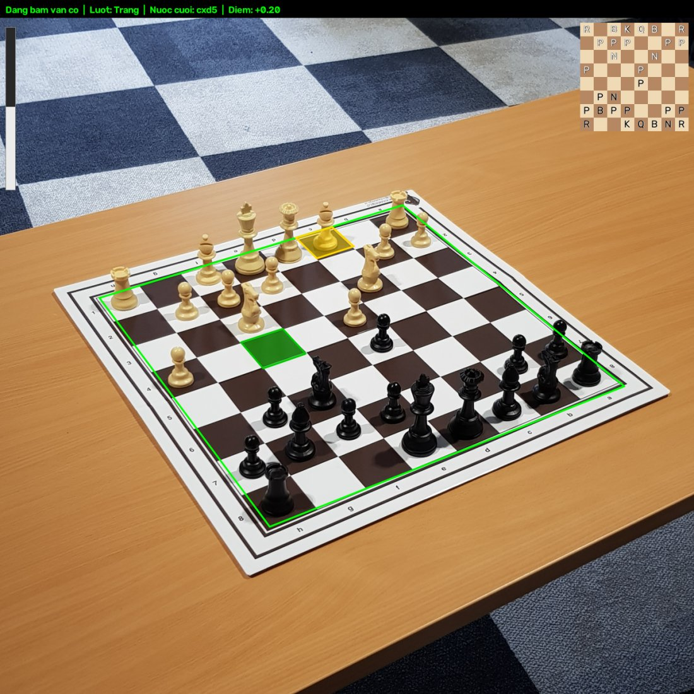
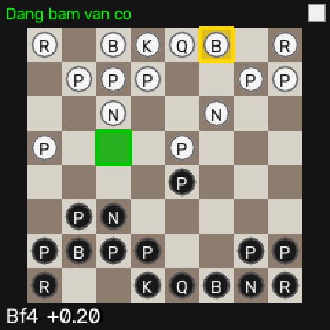
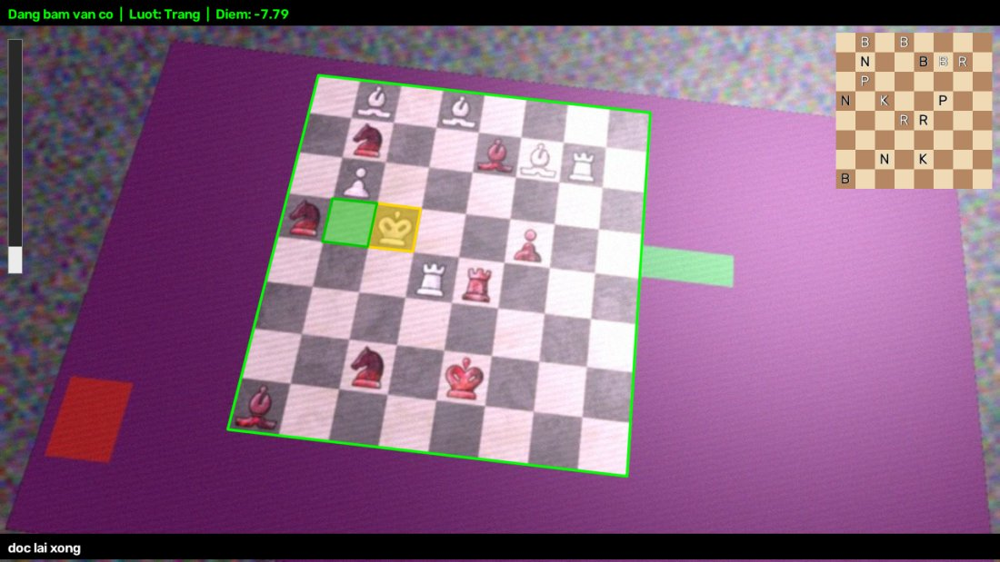
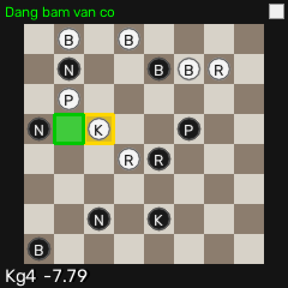
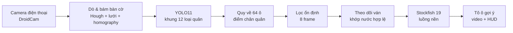

# Chess Assistant


Trợ lý cờ vua qua camera: nhìn bàn cờ (bàn cờ thật hoặc bàn cờ 2D trên màn hình) bằng camera điện thoại,
tự theo dõi ván đang chơi và **tô màu ô gợi ý nước đi tốt nhất** của Stockfish ngay trên video —
kèm màn hình HUD 240×240 chuẩn bị cho phiên bản gắn trên kính.



*Ảnh chụp kết quả thật: sau 12 nước tự ghi nhận, Stockfish gợi ý Tượng c1→f4 (ô vàng → ô xanh lá).*

---

## Mục lục

- [Tính năng](#tính-năng)
- [Ảnh minh hoạ](#ảnh-minh-hoạ)
- [Cách hoạt động](#cách-hoạt-động)
- [Kết quả](#kết-quả)
- [Yêu cầu hệ thống](#yêu-cầu-hệ-thống)
- [Cài đặt](#cài-đặt)
- [Hướng dẫn sử dụng](#hướng-dẫn-sử-dụng)
- [Huấn luyện model](#huấn-luyện-model)
- [Kiểm thử](#kiểm-thử)
- [Cấu trúc dự án](#cấu-trúc-dự-án)
- [Báo lỗi và đóng góp](#báo-lỗi-và-đóng-góp)
- [Lộ trình](#lộ-trình)
- [Nguồn dữ liệu và giấy phép](#nguồn-dữ-liệu-và-giấy-phép)

---

## Tính năng

- **Tự dò bàn cờ** — không cần bấm chọn góc; bám theo khi camera di chuyển, tự sửa khi bàn xoay hoặc camera bị
  che tạm thời.
- **Nhận diện 12 loại quân** bằng YOLO11, chạy được với bàn cờ thật (gỗ/nhựa kiểu Staunton) và bàn cờ 2D trên
  màn hình.
- **Tự nhận hướng bàn cờ** nhờ màu quân — không phải lật tay.
- **Theo dõi ván bằng luật cờ**: chỉ ghi nhận nước đi hợp lệ khớp với ảnh, chịu được vài ô đọc sai, tự bắt kịp khi
  bỏ lỡ một nước, tự đọc lại thế cờ khi bị lạc và tự đoán bên đến lượt.
- **Gợi ý cho cả hai bên** bằng Stockfish 19: tô vàng ô quân cần đi, tô xanh lá ô đích; chế độ luyện tập với sức
  mạnh giới hạn và cảnh báo nước hớ.
- **HUD 240×240** cho màn hình gắn trên kính (sơ đồ mini có tô ô gợi ý).
- Lưu ván cờ ra **PGN**.

## Ảnh minh hoạ

Tất cả ảnh dưới đây là **kết quả chạy thật** của chương trình trên ảnh test (không chỉnh sửa).

| Bàn cờ thật — video | Màn hình HUD trên kính |
|---|---|
|  |  |
| Ván test của ChessReD: hệ thống đã tự ghi nhận 12 nước, gợi ý **Bc1–f4**. Trên cùng: trạng thái, lượt, nước cuối, điểm; trái: thanh điểm; phải: sơ đồ thế cờ hệ thống đang hiểu. | Sơ đồ 240×240, phía người dùng ở dưới: ô vàng = quân cần đi, ô xanh lá = ô đích, dòng dưới = nước gợi ý + điểm. |

| Bàn cờ 2D trên màn hình — video | Màn hình HUD trên kính |
|---|---|
|  |  |
| Ảnh test mô phỏng điện thoại chụp màn hình (nghiêng, nhiễu sọc, chói). Hệ thống đọc lại thế cờ giữa ván, tự xác định lượt và gợi ý **Kf4–g4**. | Chỉ vẽ viền bàn cờ, không kẻ ô — bàn cờ thật vẫn nhìn rõ. |

Khi chưa xác định được bên đến lượt, gợi ý cho Đen hiện bằng **tông xanh dương** song song với gợi ý cho Trắng.

## Cách hoạt động



1. **Dò bàn cờ** (không cần model): tìm đường thẳng (Canny + Hough theo hướng gradient), ghép thành lưới 8×8
   bằng homography, chọn cửa sổ có ô xen kẽ sáng/tối rõ nhất. Chạy ở luồng nền, 5 frame/lần.
2. **Nhận diện quân**: YOLO11s trên cả khung hình; mỗi khung quân lấy *điểm chân* chiếu qua homography để biết đứng
   ở ô nào → xác suất 13 lớp (12 quân + trống) cho mỗi ô.
3. **Theo dõi ván**: chỉ dùng kết quả khi bàn đứng yên 8 frame; so với mọi nước hợp lệ (và chuỗi 2 nước) để chọn nước
   khớp nhất — không bao giờ tự đoán khi không chắc.
4. **Gợi ý**: Stockfish phân tích ở luồng nền, kết quả được tô lên ô thật trên video và lên HUD.

## Kết quả

| Thử nghiệm | Kết quả |
|---|---|
| Phát lại 3 ván test ChessReD (ảnh điện thoại thật, mỗi ảnh một góc chụp khác) | **303/303 nước đúng (100%)**, không ghi sai nước nào |
| Lưới bàn cờ đúng trên 330 ảnh validation / 306 ảnh test | 330/330 / 304/306 |
| YOLO11s (fine-tune trên ChessReD + bàn cờ 2D), validation 1.182 ảnh | mAP50 **0,995**, precision 0,994, recall 0,985 |
| Tốc độ (RTX 3050 laptop) | YOLO ~15–50 ms/ảnh, dò bàn cờ ~300–400 ms (luồng nền) |

## Yêu cầu hệ thống

- Windows 10/11 (đã thử), Python **3.10+**
- GPU NVIDIA khuyên dùng (đã thử RTX 3050 6 GB); chạy CPU được nhưng chậm
- Điện thoại Android/iOS cài **DroidCam** (hoặc Iriun) làm camera
- Bàn cờ thật kiểu Staunton, hoặc bàn cờ 2D trên màn hình

## Cài đặt

```bash
git clone <địa-chỉ-repo> ChessAssistant
cd ChessAssistant
python -m venv .venv
.venv\Scripts\activate
pip install -r requirements.txt
```

**Nhận diện quân (YOLO)** — cài đúng thứ tự (Ultralytics tự kéo PyTorch bản chỉ‑CPU, còn albumentations kéo bản
OpenCV không có cửa sổ):

```bash
pip install -r requirements-ml.txt
pip install --force-reinstall --no-deps torch torchvision --index-url https://download.pytorch.org/whl/cu128
pip uninstall -y opencv-python-headless
pip install --force-reinstall --no-deps opencv-python
python -c "import torch; print(torch.cuda.is_available())"
```

**Stockfish** — tải bản Windows tại [stockfishchess.org](https://stockfishchess.org/download/), giải nén file `.exe`
vào `engines/` (chi tiết: [engines/README.md](engines/README.md)). Kiểm tra:

```bash
python -m scripts.check_engine
```

**Model nhận diện quân** — đặt file đã train vào `models/pieces.pt` (tự train: xem [Huấn luyện model](#huấn-luyện-model)).

## Hướng dẫn sử dụng

### 1. Kết nối camera điện thoại (DroidCam)

1. Cài **DroidCam** trên điện thoại; điện thoại và laptop dùng **cùng mạng WiFi**.
2. Mở app, ghi lại **WiFi IP** (vd `192.168.0.100`) và port `4747`.
3. Chỉ để **một** thiết bị kết nối với DroidCam (đóng DroidCam Client trên PC / tab trình duyệt nếu có).

### 2. Chạy trợ lý

```bash
python -m scripts.play --camera http://192.168.0.100:4747/video
```

- Đặt điện thoại thấy **trọn bàn cờ**, nghiêng ~45° từ phía bạn ngồi.
- Bày **thế khởi đầu** → dòng trạng thái chuyển sang *Dang bam van co*. Giữa ván cũng được: hệ thống tự đọc thế cờ và
  tự đoán lượt ở nước đi kế tiếp.
- Mỗi lần đi xong, **rút tay khỏi bàn ~0,5 giây** để hệ thống ghi nhận.
- **Ô vàng** = quân nên đi, **ô xanh lá** = ô đích. Khi chưa rõ lượt: thêm cặp ô **xanh dương** là gợi ý cho Đen.

Dùng webcam / DroidCam Client trên PC: `--camera 1` (hoặc `0`, `2`).

### 3. Phím tắt

| Phím | Chức năng |
|---|---|
| `w` / `b` | Báo bên đến lượt ngay (thường không cần — hệ thống tự đoán) |
| `c` | Đổi màu quân của bạn (mặc định: bên gần camera) |
| `u` | Lùi nước vừa ghi nhận (khi hệ thống ghi sai) |
| `f` | Lật bàn cờ 180° (thường không cần — tự nhận hướng nhờ màu quân) |
| `r` | Dò lại bàn cờ |
| `p` | Tạm dừng / tiếp tục gợi ý |
| `q` / `Esc` | Thoát — ván cờ lưu vào `data/games/<thời-gian>.pgn` |

### 4. Tuỳ chọn

| Tuỳ chọn | Ý nghĩa |
|---|---|
| `--hud` (`--hud-scale 2`, `--hud-mirror`) | Mở thêm cửa sổ HUD 240×240 mô phỏng màn hình kính (phóng to / lật gương) |
| `--side me` | Chỉ gợi ý ở lượt của bạn (mặc định gợi ý cho cả hai bên) |
| `--multipv 3` | Hiện thêm 2 phương án phụ (viền cam ở ô đích) |
| `--think-time 1.0` | Thời gian Stockfish suy nghĩ mỗi nước (giây) |
| `--mode training --elo 1500` | Chế độ luyện tập: gợi ý ở sức mạnh giới hạn + cảnh báo nước hớ |

### 5. Demo không cần camera

Phát lại một ván thật (ảnh điện thoại của ChessReD) kèm gợi ý Stockfish, và xem các màn hình HUD mẫu:

```bash
python -m scripts.replay_chessred --show --game 33 --delay 100
python -m scripts.hud_test --scale 2
```

### 6. Công cụ khác

| Lệnh | Dùng để |
|---|---|
| `python -m scripts.live_view` | Xem lưới bàn cờ dò được + 64 ô đã cắt |
| `python -m scripts.calibrate` | Bấm chọn 4 góc bằng tay (dự phòng khi tự dò không ổn), rồi `live_view --manual` |
| `python -m scripts.replay <video> <pgn>` | Chạy lại video một ván thật, so với PGN đúng |
| `python -m scripts.eval_pieces` | Đánh giá model nhận diện quân |

## Huấn luyện model

### Dữ liệu

| Nguồn | Lệnh chuyển đổi | Ghi chú |
|---|---|---|
| **ChessReD2K** — ảnh điện thoại bàn cờ thật ([4TU](https://data.4tu.nl/datasets/99b5c721-280b-450b-b058-b2900b69a90f)) | `python -m scripts.import_chessred` | Đặt `annotations.json` + nội dung `chessred2k.zip` vào `data/downloads/chessred/` |
| **Chess Positions** — bàn cờ 2D, 28 kiểu bàn × 32 kiểu quân ([mirror HF](https://huggingface.co/datasets/smallchess/kaggle-chess-positions)) | `python -m scripts.import_chess_positions` | Biến mỗi ảnh thành ảnh mô phỏng điện thoại chụp màn hình |
| **Tự quay** — bộ cờ/game của bạn | `python -m scripts.capture_geometric --set <tên> --camera <...>` | Khung tính theo hình học, không cần model; `--pgn ván.pgn` + phím `n` để bước qua từng thế |
| Dataset YOLOv8 khác | — | Giải nén vào `data/public/<tên>/`, cần đủ 12 lớp **có màu** |

Gộp tất cả:

```bash
python -m scripts.prepare_dataset --sources "data/public/*" "data/captured/*" --out data/pieces
```

### Train trên máy (GPU NVIDIA)

```bash
python -m scripts.train_pieces --data data/pieces/data.yaml                          # train từ đầu
python -m scripts.train_pieces --data data/pieces/data.yaml --model models/pieces.pt --epochs 30   # fine-tune
```

### Train trên Google Colab (không chạy nặng máy)

1. Đóng gói: `python -m scripts.export_colab --dataset data/pieces` → thư mục `colab_upload/`
   (`pieces_dataset.zip`, `pieces.pt`, `train_colab.ipynb`). **Chờ lệnh chạy xong** rồi mới tải lên.
2. Tạo thư mục **`MyDrive/ChessAssistant/`** trên Google Drive, tải cả 3 file vào.
3. Chuột phải `train_colab.ipynb` → *Open with → Google Colaboratory* → *Runtime → Change runtime type → T4 GPU*,
   chạy lần lượt từng ô (mục 6b in chỉ số riêng cho từng nguồn dữ liệu).
4. Tải `pieces_new.pt` về, đổi tên thành `models/pieces.pt`.

Colab bị ngắt giữa chừng: đặt `RESUME = True` ở ô cấu hình và chạy lại — checkpoint nằm trên Drive.

## Kiểm thử

```bash
python -m pytest -q
```

Gồm 224 test: hình học bàn cờ, dò bàn cờ trên ảnh mô phỏng và ảnh thật, theo dõi ván (nhập thành, bắt tốt qua đường,
phong cấp, bỏ lỡ nước, đọc lại), Stockfish, overlay/HUD, chuyển đổi dữ liệu. Test cần Stockfish/model/dữ liệu ChessReD
tự bỏ qua nếu máy chưa có.

## Cấu trúc dự án

```text
chess_assistant/
├── detect.py        tự dò bàn cờ (đường thẳng → lưới → cửa sổ 8×8), xác định hướng a1
├── tracker.py       bám theo bàn cờ qua nhiều frame (luồng nền, chống rung, xác nhận khi nhảy xa)
├── board.py         homography, toạ độ ô, cắt ô
├── pieces.py        YOLO nhận diện quân
├── reading.py       quy khung quân về 64 ô (xác suất 13 lớp)
├── stability.py     chỉ dùng kết quả khi bàn đứng yên
├── game.py          theo dõi ván bằng nước đi hợp lệ, đọc lại khi lạc, tự đoán lượt
├── advisor.py       Stockfish ở luồng nền (gợi ý cả hai bên, chế độ luyện tập)
├── pipeline.py      ghép các bước cho mỗi frame, tự sửa/tự nhận hướng bàn cờ
├── overlay.py       vẽ lên video: viền bàn cờ, tô ô gợi ý, thanh điểm, sơ đồ mini
├── hud.py           màn hình 240×240 cho kính (cửa sổ laptop / ST7789 trên Raspberry Pi)
├── camera.py        mở camera / URL DroidCam, tự kết nối lại
├── engine.py        tìm và điều khiển Stockfish
├── dataset.py · chessred.py · screen2d.py · geolabel.py · autolabel.py   chuẩn bị dữ liệu
└── evaluation.py    chỉ số đánh giá
scripts/             play, replay_chessred, hud_test, capture_geometric, prepare_dataset, train_pieces, export_colab, ...
notebooks/           train_colab.ipynb
docs/                hardware/glasses_plan.md (kế hoạch gắn lên kính), images/, kế hoạch & thiết kế
tests/               pytest
engines/             đặt stockfish*.exe ở đây (không đưa vào git)
models/ · data/      model và dữ liệu (không đưa vào git)
```

## Báo lỗi và đóng góp

- Khi báo lỗi nhận diện, gửi kèm **ảnh chụp cửa sổ chương trình** (thấy cả dòng trạng thái và viền bàn cờ).
- Lỗi theo dõi ván: gửi file `data/games/*.pgn` của ván đó và mô tả nước bị ghi sai.
- Đóng góp: mở issue trước khi sửa lớn; mọi thay đổi cần kèm test và `python -m pytest -q` phải qua.

## Lộ trình

- [x] Tự dò và bám bàn cờ, tự nhận hướng
- [x] Nhận diện quân (bàn cờ thật + bàn cờ 2D), train trên Colab
- [x] Theo dõi ván, gợi ý Stockfish cho cả hai bên, tô ô gợi ý
- [x] HUD 240×240 cho màn hình kính
- [ ] Phiên bản kính (Raspberry Pi 5 + camera + màn hình ST7789) — xem [docs/hardware/glasses_plan.md](docs/hardware/glasses_plan.md)
  - [ ] Chạy không cửa sổ (`scripts/glasses.py`), nút bấm GPIO
  - [ ] Model NCNN cho CPU ARM, tối ưu tốc độ
  - [ ] Hàn, lắp lên kính, tự chạy khi bật nguồn
- [ ] Thêm dữ liệu cho game cờ 3D trên màn hình (~300 ảnh tự quay)

## Nguồn dữ liệu và giấy phép

- **ChessReD** — Masouris & van Gemert, *End-to-End Chess Recognition* (2023),
  [4TU.ResearchData](https://data.4tu.nl/datasets/99b5c721-280b-450b-b058-b2900b69a90f), **CC BY‑NC‑SA 4.0**
  (chỉ dùng phi thương mại). Ảnh minh hoạ bàn cờ thật trong README được tạo từ ảnh của bộ dữ liệu này.
- **Chess Positions** — koryakinp (Kaggle), **CC0**.
- **Stockfish** — GPL v3, tải riêng, không kèm trong repo.
- **Ultralytics YOLO** — AGPL‑3.0.

> Dự án phục vụ học tập và luyện tập. Không dùng để nhận gợi ý khi đấu với người thật (giải đấu hay trên các trang
> cờ) — đó là gian lận và vi phạm luật chơi.
